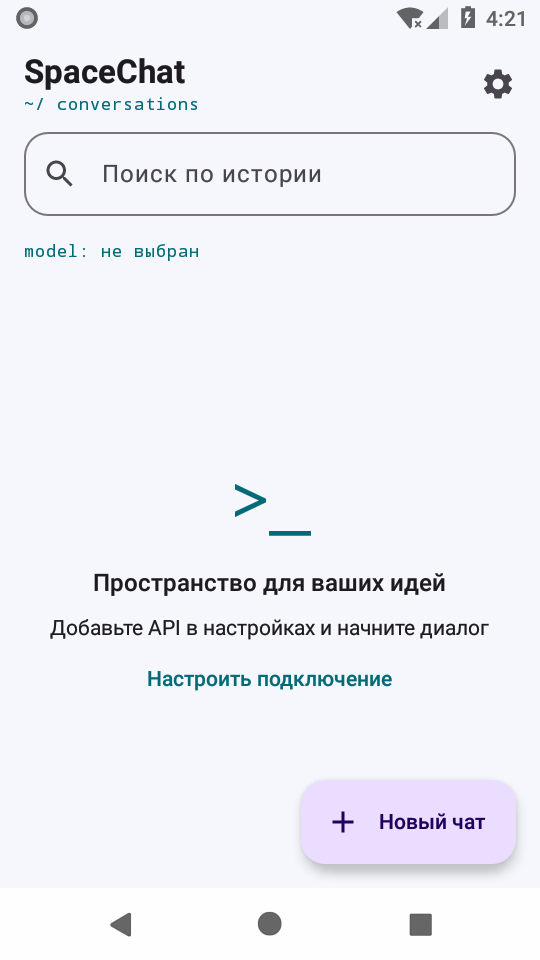

# SpaceChat

Лёгкий нативный Android-клиент для общения с пользовательским OpenAI-совместимым API. Kotlin, Jetpack Compose, Material 3. Android 8.0+ (API 26). Стандартный desugaring Java API обеспечивает совместимость CommonMark с Android 8–9.

## Возможности версии 0.1

- Terminal Space: светлая и тёмная темы, три акцента, динамические цвета Android 12+.
- Диалоги в Room: поиск по названиям и сообщениям, переименование, удаление, отдельная модель для каждого чата.
- SSE-ответы, остановка генерации, ручной повтор, редактирование сообщений с пересозданием последующего контекста.
- Markdown, списки, цитаты, блоки кода с простой лексической подсветкой, копирование сообщений и кода. HTML отображается как текст. Во время генерации используется простой текст; Markdown применяется после завершения.
- Base URL, API Key, ручной Model ID, получение списка моделей, System prompt, таймаут чтения 10–600 секунд.
- Изображения JPEG / PNG / WebP через Storage Access Framework: до 12 МБ, уменьшение до 1600 пикселей по длинной стороне, JPEG. Требуется явное включение `image_url` и поддержка со стороны API и модели. В интерфейсе отображается отметка вложения.
- Отмена запроса, сохранение частичных ответов, обработка HTTP-ошибок и `Retry-After`. Автоматического повтора платных запросов нет.
- Без аналитики, рекламы, WebView и фоновых служб.

Идентификаторы моделей приложение не выдумывает: выберите полученный от сервера ID либо введите его из документации своего провайдера.

## Скриншот

Реальный запуск на Android 8.0 (API 26), светлая тема:



## Сборка

Нужны JDK 17, Android SDK Platform 35 и Build Tools 35.0.0. Android Studio с установленным SDK подходит.

```sh
# Локально: создайте local.properties с sdk.dir=/абсолютный/путь/к/Android/Sdk
./gradlew assembleDebug
./gradlew lintDebug testDebugUnitTest
# С подключённым устройством или эмулятором:
./gradlew connectedDebugAndroidTest
```

Windows: `gradlew.bat`. APK: `app/build/outputs/apk/debug/app-debug.apk`.

```sh
adb install -r app/build/outputs/apk/debug/app-debug.apk
```

Debug APK предназначен для тестирования. Для публичного production-релиза нужно отдельно настроить постоянный signing key и release-конфигурацию. Не храните ключ подписи и пароли в Git.

## Первое подключение

1. Откройте настройки. Введите HTTPS Base URL и API-ключ.
2. Нажмите «Проверить API / получить модели» либо введите Model ID вручную. Проверка вызывает `/models`; недоступность этого endpoint не означает, что чат не поддерживается.
3. Сохраните настройки и создайте чат. Модель существующего диалога меняется через его верхний селектор.
4. При необходимости включите изображения после проверки поддержки `image_url` провайдером.

`https://host` превращается в `https://host/v1/chat/completions`, `https://host/v1` — в тот же endpoint. Префиксы шлюза сохраняются: `/gateway/v1` → `/gateway/v1/chat/completions`. Указывайте базовый адрес, а не полный путь `chat/completions`. HTTP, query, fragment и credentials в URL запрещены. Редиректы не выполняются, чтобы не передавать Authorization на другой адрес.

Приложение отправляет только базовый OpenAI-совместимый формат `messages`, `model`, `stream`. Поддержка tools, reasoning-полей и других расширений не предполагается. Ошибки 401/403, 404, 429 и 5xx отображаются отдельно. При 429 ручной повтор блокируется на `Retry-After` (или на 5 секунд без заголовка). Неполный assistant-ответ сохраняется, но не включается в следующий контекст. Повтор ответа использует последнее пользовательское сообщение; новый ввод отправляйте кнопкой отправки.

## Хранение и безопасность

Все настройки, включая API-ключ, зашифрованы AES-256-GCM; ключ шифрования генерируется Android Keystore. Запись атомарная, файл находится в `noBackupFilesDir`. API-ключ не попадает в обычные SharedPreferences, instance-state Bundle, исходники или логи. При недоступности Keystore можно явно сбросить настройки, сохранив историю.

История хранится в приватной директории приложения в Room. **Сообщения и изображения не имеют дополнительного шифрования базы**; они защищены Android sandbox и шифрованием устройства. Android backup отключён. Содержимое диалогов и ключ отправляются указанному пользователем серверу: выбирайте доверенный API. TLS-проверка включена; доверие самоподписанным сертификатам не добавляется. Ответы ошибок API не показываются напрямую, поскольку сервер может вернуть чувствительные данные.

## Архитектура

```text
Compose UI → SpaceViewModel (StateFlow, SavedStateHandle)
                    ↓
             ChatRepository
             ↙            ↘
    Room + Attachments   ChatProvider
                         └─ OpenAiProvider (OkHttp SSE)
    SecureSettings → Android Keystore + encrypted AtomicFile
```

Room хранит только начало и итог генерации; каждый токен не записывается в базу. Поток обновляет отдельный компонент ответа максимум 20 раз в секунду; остальные сообщения не подписаны на текст потока. `LazyColumn` использует стабильные ID. Автопрокрутка прекращается при просмотре старых сообщений, доступна кнопка возврата вниз. ViewModel переживает поворот экрана; после завершения процесса незавершённые сообщения помечаются как прерванные. Сетевые операции, шифрование, чтение файлов и декодирование изображений выполняются вне главного потока.

Для других провайдеров реализуется `ChatProvider`; для документов — `AttachmentHandler`. PDF, TXT, Markdown и исходный код пока отклоняются как вложения и не отправляются в API; текст можно вставить в сообщение. `HistoryArchive` задаёт границу будущего экспорта/импорта, реализация пока отсутствует.

Deep Research **отключён**. Интерфейс `ResearchAgent` предусматривает прогресс и источники. Для включения нужна реальная интеграция с исследовательским API либо собственный агент с поиском и сохранением результатов; обычный chat completion за исследование не выдаётся.

## Проверки и CI

- JUnit + MockWebServer: нормализация URL, контекст и system message, Unicode SSE и фрагментация, завершение/обрыв, отмена, 429, редиректы, ошибки, модели и image_url.
- Android instrumentation: Room после повторного открытия, каскадное удаление, поиск, восстановление прерванных ответов, Keystore и обнаружение повреждения ciphertext.
- Compose smoke test: запуск, настройки, создание чата, сохранение ввода при отсутствии подключения.
- GitHub Actions: lint, unit tests, сборка APK, инструментальные тесты на эмуляторах API 26 и 30, APK и отчёты в Artifacts. Тег `v*` публикует prerelease с явной пометкой **DEBUG / TEST** после успешных проверок.

CI не использует пользовательские API-ключи. Совместимость с конкретным MultiAPI нужно проверить на реальном сервере; mock-тесты проверяют протокол, но не возможности стороннего провайдера.

## Ограничения и следующие шаги

Нет экспорта/импорта, настоящего Deep Research, tools, ветвления истории и поддержки документов как вложений. Подсветка кода лексическая, без полноценного парсера языков. Вложения отображаются отметкой, без галереи. Генерация не является фоновой задачей: после уничтожения процесса её нужно повторить вручную. Неограниченное накопление истории требует достаточного свободного места. Перед production-релизом нужны тестирование на реальных устройствах и API, постоянная подпись, профиль производительности и проверка доступности интерфейса.

## Лицензия

Apache License 2.0 — см. [LICENSE](LICENSE).
